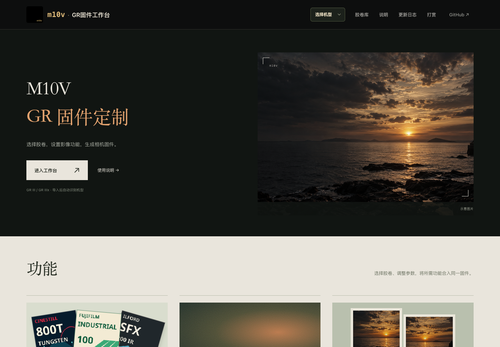

<div align="center">


# M10V

**Ricoh GR 固件定制工作台**

[打开工作台](https://m10v.izhaoo.com/) · [使用说明](https://m10v.izhaoo.com/guide/) · [胶卷库](https://m10v.izhaoo.com/gr3/sd-library.html) · [更新日志](https://m10v.izhaoo.com/changelog/)

</div>



选择胶卷、调整本卷参数、搭配影像功能，生成对应相机的固件。**GR III / IIIx 共用一个工作台**，导入官方文件后自动识别机型；GR IV 与 GR II 使用各自的适配。

> **这是非官方修改固件工具。** 刷入可能导致无法启动、数据丢失或设备损坏，且无法保证恢复。离线校验与网页生成成功不代表所有相机、功能组合均已通过实测；各版本的验证范围见[更新日志](https://m10v.izhaoo.com/changelog/)。

## 功能

### 胶卷与成像

| 功能 | 用途与使用方式 |
| --- | --- |
| 胶卷库 | GR III 有 **51 款**、IIIx 有 **47 款胶卷风格**，均为 **6 个分类**，最多启用 **10 款**；原厂预设保留，机内可继续装卷、换卷 |
| 本卷参数 | 原厂颗粒按胶卷独立设置关闭、弱、中、强；800T、蓝凤凰和 Harman Red 保留各自的光晕或模拟曝光 EI |
| 自定义 LUT | 导入 sRGB 3D `.cube`，生成配套胶卷包；使用可表达的 ISP 色彩近似，支持 GR III / IIIx |
| 色调取景 | GR III / IIIx 已接入原生 ISP 胶卷色调；光晕、HDF、边框与印字等效果以静态成片为准 |

### 影像方案

**除胶卷库外，新方案的扩展功能默认关闭。** 所有开关集中在「影像方案」，开启后展开对应设置；已有草稿保留上次选择。

| 功能 | 用途 |
| --- | --- |
| 光晕 | 高光溢出或横向拉丝，机内按胶卷调节模式、强度、范围与阈值 |
| HDF 模拟 | 独立数字柔焦，可单独使用或与胶卷库组合，不随换卷重置 |
| 边框 | 拍立得或 135 胶卷边框，向外扩展画布并保留完整构图 |
| 时间与名称水印 | 日期、时间、胶卷名称，以及格式、四角位置和颜色 |
| 画幅比例 | GR III / IIIx 增加 4:3、16:9、6x7、XPan 与取景蒙版；GR IV 为 65:24 |
| Half 半格双拍 | GR III 连拍两张组成双画面，带黑色中央分隔条，保留首张原图 |
| 两档裁切焦距 | GR III：28–50 mm；IIIx：40–71 mm，按 1 mm 调整；可选择在本次更新写入预设 |
| 原厂负片颗粒 | 为原厂负片风格开放颗粒调节 |
| RAW 降噪 | 使用原厂策略、关闭降噪，或设置开始降噪的 ISO |
| 滑轨水平仪 | 显示左右倾斜与前后俯仰 |
| A/B 快切 | 在两种原厂风格或胶卷之间切换；机内设置配对，取景中短按 DISP 切换 |
| 开关机画面 | 上传图片、调整裁切并应用；关闭时保留图片草稿，导出使用原厂画面 |
| 高级设置 | 可选诊断日志；GR IIIx 保留独立的单包版本适配选项 |

上表是功能总览，**并非每款机型均支持全部功能**。工作台会禁用不支持的选项；具体范围与操作入口见[完整说明](https://m10v.izhaoo.com/guide/#features)。

## 机型与状态

| 机型 | 工作台能力 | 构建基线 / 文件 |
| --- | --- | --- |
| **GR III** | 原生 ISP 胶卷、最多十款已选胶卷、机内参数、SD 换卷及影像扩展；部分功能已有用户实测反馈 | Street Edition 2.10 / `fwdc239b.bin` |
| **GR IIIx** | 与 III 共用胶卷与主要影像能力，保留本机身份、CPU 与镜头范围；设备验证范围单独记录 | 1.60 / `fwdc243b.bin` |
| **GR IV** | 独立原生适配，五个胶卷位置、静态 JPEG 胶卷与时间水印；具体目录和扩展按工作台显示，仍待实机验证 | 1.11 / `fwdc248b.bin` |
| **GR II** | 五槽胶卷、水印、HDF 设置与实验固件构建；完整启动与拍摄仍待实机验证，另有[只读检查入口](https://m10v.izhaoo.com/gr2/inspect/) | 3.00 / `rg2_v003.frm` |

导入版本与构建基线可能不同，请以工作台核验结果为准。GR IV 的[原厂参数参考工具](https://m10v.izhaoo.com/gr4/reference/)单独保留。

## 使用流程

### 1. 导入官方固件

在[工作台](https://m10v.izhaoo.com/)选择机型，上传对应的官方文件，或使用提供的官方样本。确认上传版本、输出基线，并保留官方原包与个人数据备份。

### 2. 设置胶卷与功能

- 在「胶卷设置」选卷，调整当前胶卷的参数。
- 在「影像方案」开启所需扩展；开关机图片也在此处展开编辑。
- 草稿保存在当前浏览器，支持撤销、重做；修改方案会使旧预检失效。

### 3. 保存固件与胶卷库

核对方案并阅读风险提示，生成后下载固件及配置记录。启用胶卷库时，下载配套胶卷包，将解压得到的 `SD/M10V` 文件夹放入卡根目录，与 `DCIM` 并列，再按相机官方更新流程安装。

**更新胶卷资源时，只替换 `FILMS.M10`，保留其他设置文件。** 已有机内 M10V 记录优先，网页初始配置不会自动覆盖全部机内设置；焦距的一次性写入有单独开关。

### 成像边界

- 胶卷效果主要作用于保存的 JPEG，机内 RAW 再开发仍沿用原厂流程。
- RAW 降噪是独立扩展，会调整写入 DNG 前的 Bayer 降噪；不等同于 JPEG 降噪或胶卷颗粒。
- 自定义 LUT、Charmera、像素化风格和部分胶卷模拟有各自的近似与性能边界，不保证与实片或其他实现逐像素一致。
- 工作台只生成文件，不自动刷写相机。各机型与候选的实测结果不能互相代替。

## 本地运行

推荐 Node.js 24；最低要求 **Node.js 20、Python 3、LLVM clang 与 LLD**。Node 服务使用内置模块，无需安装 npm 依赖。

```bash
git clone https://github.com/zhaoo/m10v.git
cd m10v
python3 -m venv .venv
.venv/bin/python -m pip install pillow numpy capstone unicorn
```

macOS 安装工具链：

```bash
brew install llvm lld
```

自行准备官方固件，文件不随仓库分发：

```text
bin/
├── fwdc239b-gr3-official.bin       # GR III Street Edition 2.10
├── fwdc243b-gr3x-official.bin      # GR IIIx 1.60
├── fwdc248b-gr4-officical.bin      # GR IV 1.11，沿用现有文件名
└── rg2_v003.frm                   # GR II 3.00
```

```bash
npm start
```

打开终端显示的地址。macOS 也可双击 `start.command`。服务默认只监听本机；服务器部署使用 `M10V_PORT` 和 `M10V_PUBLIC_ORIGIN`，详见[部署说明](deploy/README.md)。

<details>
<summary><strong>可选运行时与开发环境</strong></summary>

部分原厂工具组合需要锁定的兼容运行时：

```bash
node scripts/sync-grlife-runtime.mjs --current
```

该路径推荐 Python 3.12，可通过 `M10V_PYTHON` 指定解释器。自定义 LLVM 安装路径用 `M10V_LLVM_CLANG` 指定 clang 完整路径。GR IV 参考核心位于 `vendor/gr4/`，来源与许可见[第三方说明](THIRD_PARTY_NOTICES.md)。

部分历史测试读取根目录别名，可按需建立：

```bash
ln -s bin/fwdc239b-gr3-official.bin fwdc239b-offical.bin
ln -s fwdc239b-offical.bin fwdc239b.bin
```

官方固件、照片样本、`.venv/`、`.runtime/`、`data/` 和 `builds/` 不提交到 Git。GR IV 校准样本的文件名与哈希见 `vendor/gr4/PROVENANCE.json`。

</details>

## 开发与验证

`main` 是发布源码分支，`develop` 用于日常开发。分支名和构建成功均不表示固件已通过实机验收。

```bash
# JavaScript、HTTP、固件容器与导出检查
npm test

# 原生与 ARM 执行检查
.venv/bin/python -m unittest \
  tests.test_gr3_m10v_library \
  tests.test_gr3_m10v_library_arm \
  tests.test_gr3_m10v_capture

# 与网页共用构建链的本地导出
node scripts/export_gr3_m10v_native.mjs builds/gr3-test
node scripts/export_gr3_m10v_native.mjs --model=gr3x builds/gr3x-test
```

完整回归需要官方固件、对应参考样本与运行时。当前全量测试仍有旧目录合同和本地样本相关失败，不能将定向通过记为全量通过；本轮范围与失败索引见[网页与影像方案审核记录](docs/testing/2026-10-31-web-imaging-review.md)。

| 目录 | 内容 |
| --- | --- |
| `web/` | 页面、胶卷目录与使用说明 |
| `node/` | HTTP 服务、身份核验、构建与独立回读 |
| `native/` | 各机型原生菜单、成像与持久化 |
| `scripts/` | 编译、资源生成、导出与分析 |
| `tests/` | 原生和 ARM 执行回归 |
| `docs/` | 研究证据、验收与发布记录 |

## 名称与来源

GR III 官方 Linux 根文件系统的 `/etc/hostname` 为 `m10v`，项目沿用这一名称。[来源证据](docs/research/m10v-name-origin.md)。

参考项目包括 **gr-custom-tool、GRLife、gr3-film-mods、darkslide-gr**。第三方代码与数据保留对应来源和许可，详见 [THIRD_PARTY_NOTICES.md](THIRD_PARTY_NOTICES.md)。项目源码采用 [GPL-2.0](LICENSE)。
